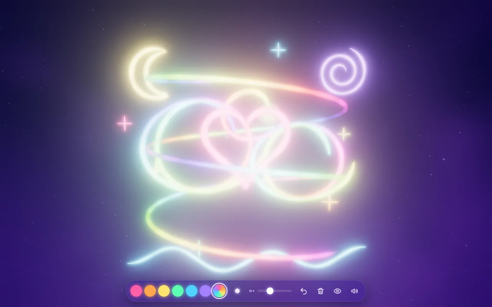
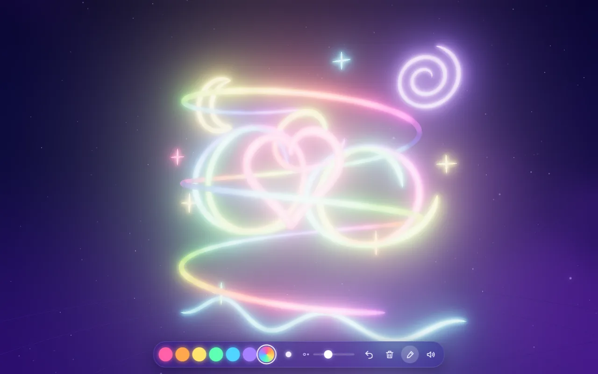

# Glow Paint

<a href="https://orbworlds.com/orb/glow-paint?utm_source=github&utm_medium=readme&utm_campaign=glow-paint"></a>

Draw glowing strokes in 3D and look at them from every side. Change the brush size and how far from you the paint lands, undo, or clear it all and start again.

**[Play it on Orb](https://orbworlds.com/orb/glow-paint?utm_source=github&utm_medium=readme&utm_campaign=glow-paint)**. It runs in the browser on a computer, phone or tablet, and you
don't need an account.

<p>
  
</p>

## Controls

Drag to paint. L switches to looking around, Ctrl+Z undoes, and the buttons change the brush size and depth.

## Run it yourself

```bash
git clone https://github.com/orbworlds/glow-paint
cd glow-paint
npm start
```

That opens it at http://127.0.0.1:4242 with the [Orb kit](https://github.com/orbworlds/kit),
which gives the game what it gets on Orb: other players (open a second tab, or press **+ Player**), saves and shared state.
You need Node 20 or newer, and nothing else.

The whole thing is `index.html`, 399 lines of HTML, CSS and JavaScript with
[three.js](https://threejs.org) from a CDN. Edit it and the page reloads.

What it uses from Orb's world SDK (`window.orb`, typed in [`orb-kit/orb.d.ts`](orb-kit/orb.d.ts)):

- plain `localStorage` for progress, which Orb saves per player and brings along to their other devices

Outside Orb and the kit, `window.orb` isn't there and the game carries on without it.

## Make your own version

You can remix it on Orb without touching code: [open it there](https://orbworlds.com/orb/glow-paint?remix&utm_source=github&utm_medium=readme&utm_campaign=glow-paint), choose
**Make my own copy** and describe what you'd change. Orb's AI makes the changes in your copy.

Or fork this repository, make your changes and push them. `npm run share` then prints a link that
brings your fork into Orb as a world of your own, credited as a remix of this one, and it stays in
sync with your fork from then on.

## Contributing

Pull requests are welcome. GitHub checks each one by running the world in a headless browser, which has to go without errors,
and once a change is merged it's live on Orb within about 15 minutes. [CONTRIBUTING.md](CONTRIBUTING.md)
has the details.

## License

MIT, see [LICENSE](LICENSE). The Orb name and logo aren't covered by the license.
